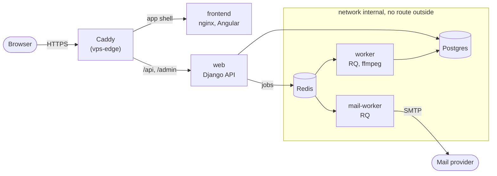

# videoflix-deploy

Deployment configuration for [Videoflix](https://github.com/PhilippKlinger/videoflix-backend): the single place that defines which image versions run in production.

The application repositories ([backend](https://github.com/PhilippKlinger/videoflix-backend), [frontend](https://github.com/PhilippKlinger/videoflix-frontend)) only build and push images to GHCR. This repository pins those images by digest and rolls them out to the VPS, so one commit equals one running combination.

## Architecture

Caddy reaches `frontend` and `web` over the shared network `edge`; only `mail-worker` has a route outside (network `outbound`).

## Contents

- `compose.yaml`: `web` (Gunicorn), `worker` (RQ, ffmpeg) and `mail-worker` (RQ, account mails) from the backend image, `demo-cleanup` (expired demo accounts every 10 minutes), `frontend` (nginx), Postgres 18 and Redis 8; all images pinned by digest, healthchecks, `depends_on` with conditions, dropped capabilities
- Networks: `internal` (no route outside, database and Redis), `outbound` (SMTP for `mail-worker` only) and the shared `edge` network of [vps-edge](https://github.com/PhilippKlinger/vps-edge) with the aliases `videoflix-web` and `videoflix-frontend`; no service publishes ports
- `.env.example`: every variable with purpose and whether it is required
- `.github/workflows/deploy.yml`, `scripts/`: deploy with smoke test and automatic rollback
- `backup/`: backup and restore test scripts, systemd service and timer
- `restore-test.json`: date and result of the last restore test
- `.github/workflows/ci.yml`, `security.yml`, `codeql.yml`, `scorecard.yml`: the checks below

TLS and routing are handled by [vps-edge](https://github.com/PhilippKlinger/vps-edge).

## What CI checks

Every pull request to `main` must pass these checks before a merge, pin pull requests included:

- **Validate compose, scripts and workflows:** compose validation with the complete `.env.example`, shellcheck, actionlint
- **Start pinned stack and check security properties:** a real start of the pinned stack (health, app shell, no published ports, separated networks, non-root containers)
- **Scan pinned images (Trivy):** every pinned image, also weekly for vulnerabilities published later
- **Security checks:** secret scan (gitleaks), workflow lint (zizmor), CodeQL for the workflows

## Logs

All services log to journald instead of `json-file`, because `json-file` can only rotate by size. The time limit of 14 days from the privacy policy is set on the host, see [vps-edge](https://github.com/PhilippKlinger/vps-edge). Reading logs stays the same: `docker compose logs`.

## Deploy and rollback

`.github/workflows/deploy.yml` rolls out one image at a time, in the GitHub Environment `production`:

1. Trigger: `repository_dispatch` of type `image-published` from the backend or frontend CI (`{service, digest}`), or started by hand with `workflow_dispatch`
2. `scripts/deploy.sh` runs on the server over SSH: it remembers the running images and commit, pulls this repository, writes the digest to the gitignored `compose.override.yaml` and starts the stack with `docker compose up --wait`
3. `scripts/smoke-test.sh` checks from the runner, the way a visitor comes in: `/api/health/` reports database and cache as ok, the start page serves the app, the certificate is valid for at least 7 more days
4. On failure the previous images and commit are restored and checked again; the run stays red
5. On success a pull request pins the digest in `compose.yaml`; merging it records the state and does not deploy again

**Pin pull requests and required checks:** `main` requires the CI checks, but a pull request opened with the `GITHUB_TOKEN` starts no workflows (GitHub prevents loops). Close and reopen the pin pull request once; the reopen starts the checks, then merge.

Secrets of the Environment: `SSH_HOST`, `SSH_PORT`, `SSH_USER`, `SSH_PRIVATE_KEY`, `SSH_KNOWN_HOSTS`. The server keeps its own `.env`.

**Roll back by hand:** Actions → Deploy → Run workflow, choose the service and enter an earlier digest (the deploy summaries and the history of `compose.yaml` list them). Run this for one service at a time.

**Limits of a rollback:** the backend applies migrations at startup and they are not reverted, so an older backend image must still work with the newer schema. An image without the `mail-worker` command only runs together with a `compose.yaml` from before that service. Recreating the worker interrupts a running conversion.

**Without the workflow:** on the server `docker compose pull && docker compose up -d`; `compose.override.yaml` applies to manual commands as well. Delete that file to go back to the digests in `compose.yaml`.

## Backup and restore

`backup/backup.sh` writes a Postgres dump every day and a media archive once a week (and on the first run), into a backup directory on the server outside the stack. Dumps are kept for 14 days, the last 2 media archives stay. `.env` is not part of the backup: keep its values in a password manager, a restore needs them.

**The backups stay on the VPS.** They protect against bad deployments and deleted data, not against losing the server.

A systemd timer from `backup/` runs the backup every night. Restore test: restores into the separate database `videoflix_restore_test`, compares the row counts with the live database, checks that the archive contains every file the database refers to, and drops the copy again. Live data stays untouched.

`restore-test.json` in the repository root records the date and result of the last restore test. A real restore stops `web`, `worker`, `mail-worker` and `demo-cleanup`, replaces the database with `pg_restore` and unpacks the media archive into the media volume; the site is down meanwhile. The step-by-step commands are kept in the private operator runbook.

## Troubleshooting

Sorted by what the monitors report (Videoflix · Web-App, Videoflix · API). Commands run in `/srv/videoflix`. Proxy and certificate problems are in the runbook of [vps-edge](https://github.com/PhilippKlinger/vps-edge#troubleshooting).

### Deploy rolled back

**Symptom:** a short outage during a deploy, the Deploy run is red.

**Check:** the run summary in Actions → Deploy shows the failed step (pull, start, smoke test) and whether the check after the rollback passed.

**Fix:** if the rollback check passed, the server needs nothing; fix the image in the application repository, the next published image deploys again. If it failed, continue with [Regression after deploy](#regression-after-deploy).

**Way back:** none needed, the previous images are running.

### Regression after deploy

**Symptom:** errors shortly after a green deploy (API errors, broken pages).

**Check:** `docker compose ps`, `docker compose logs --since 30m web worker frontend`; compare `docker compose images` and `/version.json` with the deploy summary.

**Fix:** [roll back by hand](#deploy-and-rollback) to the previous digest, one service at a time; mind the limits of a rollback (migrations are not reverted).

**Way back:** deploy the fixed image once it is published.

### Database or cache not ok

**Symptom:** `/api/health/` reports database or cache not ok, the API monitor is down while the web app may still load.

**Check:** `docker compose ps db redis`, `docker compose logs --tail 50 db redis`, `df -h /var/lib/docker` for a full disk.

**Fix:** `docker compose up -d db redis`, then `docker compose restart web`. Disk full → remove old images (`docker image prune`) or old backups; never delete a volume.

**Way back:** a damaged database is restored from the backup, see [Backup and restore](#backup-and-restore).

### Web crash loop

**Symptom:** the API returns 502, the web app shell still loads.

**Check:** `docker compose ps web` shows `restarting`; `docker compose logs --tail 80 web` shows the reason. Typical are a new setting of the backend without a value in `.env`, or a migration that fails at startup.

**Fix:** missing value → add it to `.env` (`.env.example` lists every variable), then `docker compose up -d web worker mail-worker`. Failing migration → roll the backend image back ([Deploy and rollback](#deploy-and-rollback)) and fix the migration in the backend.

**Way back:** deploy the fixed backend image.

### API 5xx

**Symptom:** the API returns 500 while `web` is healthy.

**Check:** `docker compose logs --since 15m web` shows the traceback. A 400 instead of a 500 points to the allowed hosts in `.env`.

**Fix:** error in the code → roll the backend image back; wrong setting → correct `.env`, then `docker compose up -d web`.

**Way back:** deploy the fixed backend image.

### App shell error

**Symptom:** the web app returns 404 or 502, the API works.

**Check:** `docker compose ps frontend`, `docker compose logs --tail 50 frontend` for an nginx error or missing files.

**Fix:** roll the frontend image back ([Deploy and rollback](#deploy-and-rollback)).

**Way back:** deploy the fixed frontend image.

### App shell stale

**Symptom:** no alert; the web app works but shows an older version.

**Check:** `/version.json` and `docker compose images frontend` against the latest deploy summary. A leftover `compose.override.yaml` keeps an old digest.

**Fix:** deploy the current digest by hand, or delete `compose.override.yaml` and run `docker compose up -d` (see *Without the workflow* above).

**Way back:** none needed.

## Related repositories

| Repository | Role |
|---|---|
| [videoflix-backend](https://github.com/PhilippKlinger/videoflix-backend) | Builds and publishes the backend image (`web`, `worker`, `mail-worker`, `demo-cleanup`) |
| [videoflix-frontend](https://github.com/PhilippKlinger/videoflix-frontend) | Builds and publishes the frontend image (nginx) |
| [vps-edge](https://github.com/PhilippKlinger/vps-edge) | Caddy with TLS in front of the stack, network `edge` |
| [vps-monitoring](https://github.com/PhilippKlinger/vps-monitoring) | Uptime Kuma checks the web app and the API |
| [vps-incident-assistant](https://github.com/PhilippKlinger/vps-incident-assistant) | Turns alerts into issues and uses the Troubleshooting section below as runbook |
| [v-server-setup](https://github.com/PhilippKlinger/v-server-setup) | How the server is set up and hardened |

## License

[MIT](LICENSE)
